

  <b>English</b>&nbsp;&nbsp;·&nbsp;&nbsp;<a href="https://github.com/Diganme-Gaby/Diganme-Gaby/blob/main/README.es.md">Español</a>

<picture><source media="(prefers-color-scheme: dark)" srcset="assets/header-dark.svg"></picture>

<h2 align="center">{ Selected work }</h2>

  <a href="https://credito.millersolutionsco.com"><picture><source media="(prefers-color-scheme: dark)" srcset="assets/work-credito-dark.svg"></picture></a>
  <picture><source media="(prefers-color-scheme: dark)" srcset="assets/work-market-dark.svg"></picture>
  <a href="https://github.com/chocolistolisto/labrador"><picture><source media="(prefers-color-scheme: dark)" srcset="assets/work-labrador-dark.svg"></picture></a>
  <a href="https://academy.logaligroup.com/mod/simplecertificate/verify.php?code=e17c40fd-e8a3-423b-b80a-35fe691bd1c6"><picture><source media="(prefers-color-scheme: dark)" srcset="assets/work-sap-dark.svg"></picture></a>
  <a href="https://github.com/Diganme-Gaby/Diganme-Gaby/tree/main/labs/vlsm-tres-sedes"><picture><source media="(prefers-color-scheme: dark)" srcset="assets/work-lab-dark.svg"></picture></a>

<h2 align="center">{ Certifications }</h2>

  <picture><source media="(prefers-color-scheme: dark)" srcset="assets/cert-itn-dark.svg"></picture>&nbsp;<picture><source media="(prefers-color-scheme: dark)" srcset="assets/cert-cyber-dark.svg"></picture>
   
  <a href="https://ude.my/UC-65f6783b-3e8e-442f-9fec-594df5bf49ca"><picture><source media="(prefers-color-scheme: dark)" srcset="assets/cert-wordpress-dark.svg"></picture></a>&nbsp;<a href="https://academy.logaligroup.com/mod/simplecertificate/verify.php?code=e17c40fd-e8a3-423b-b80a-35fe691bd1c6"><picture><source media="(prefers-color-scheme: dark)" srcset="assets/cert-sap-dark.svg"></picture></a>

<h2 align="center">{ Right now }</h2>

  <picture><source media="(prefers-color-scheme: dark)" srcset="assets/now-dark.svg"></picture>

<h2 align="center">{ Toolkit }</h2>

  <picture><source media="(prefers-color-scheme: dark)" srcset="assets/stack-dark.svg"></picture>

 

  <a href="mailto:diazlauragabriela0307@gmail.com"><picture><source media="(prefers-color-scheme: dark)" srcset="assets/contact-dark.svg"></picture></a>
   
  <b>Email</b>&nbsp;&nbsp;<a href="mailto:diazlauragabriela0307@gmail.com">diazlauragabriela0307@gmail.com</a> 
  <b>Instagram</b>&nbsp;&nbsp;<a href="https://www.instagram.com/diganmegaby">@diganmegaby</a>

  <b>English</b>&nbsp;&nbsp;·&nbsp;&nbsp;<a href="https://github.com/Diganme-Gaby/Diganme-Gaby/blob/main/README.es.md">Español</a>

