<p align="center">
  <a href="https://github.com/Diganme-Gaby">← Volver al perfil</a>
</p>

# VLSM en tres sedes

> **EN —** Cisco Packet Tracer lab: `192.168.0.0/24` split with VLSM for three sites (Bogotá, Medellín, Barranquilla), three routers connected by `/30` serial links, and static routing between every LAN.

Red de tres sedes diseñada a partir de una sola red `192.168.0.0/24`, dividida con **VLSM** según la cantidad de hosts que necesita cada LAN. Los tres routers quedan conectados en triángulo por enlaces seriales `/30` y se comunican con **rutas estáticas**.

<picture><source media="(prefers-color-scheme: dark)" srcset="../../assets/es/topology-dark.svg"></picture>

## Plan de direccionamiento

| Red | Hosts requeridos | Dirección de red | Máscara | Rango útil | Gateway |
|---|---|---|---|---|---|
| LAN Bogotá | 55 | `192.168.0.0/26` | 255.255.255.192 | .1 – .62 | 192.168.0.1 |
| LAN Medellín | 40 | `192.168.0.64/26` | 255.255.255.192 | .65 – .126 | 192.168.0.65 |
| LAN Barranquilla | 10 | `192.168.0.128/28` | 255.255.255.240 | .129 – .142 | 192.168.0.129 |
| Enlace Bogotá – Medellín | 2 | `192.168.0.144/30` | 255.255.255.252 | .145 – .146 | — |
| Enlace Bogotá – Barranquilla | 2 | `192.168.0.148/30` | 255.255.255.252 | .149 – .150 | — |
| Enlace Barranquilla – Medellín | 2 | `192.168.0.152/30` | 255.255.255.252 | .153 – .154 | — |

## Equipos

| Equipo | Modelo | Interfaces |
|---|---|---|
| R-BOG | Cisco 2911 | G0/0 `192.168.0.1/26` · S0/3/0 `192.168.0.145/30` · S0/3/1 `192.168.0.149/30` |
| R-MDE | Cisco 2901 | G0/0 `192.168.0.65/26` · S0/3/0 `192.168.0.146/30` · S0/3/1 `192.168.0.154/30` |
| R-BQ | Cisco 2901 | G0/0 `192.168.0.129/28` · S0/3/0 `192.168.0.150/30` · S0/3/1 `192.168.0.153/30` |
| Switch1–3 | Cisco 2960-24TT | Capa 2, sin IP |
| PC-BOG-1 / PC-BOG-2 | PC | `192.168.0.2` / `192.168.0.62` |
| PC-MDE-1 / PC-MDE-2 | PC | `192.168.0.66` / `192.168.0.126` |
| PC-BQ-1 / PC-BQ-2 | PC | `192.168.0.130` / `192.168.0.142` |

## Enrutamiento estático

```
R-BOG(config)# ip route 192.168.0.64  255.255.255.192 192.168.0.146
R-BOG(config)# ip route 192.168.0.128 255.255.255.240 192.168.0.150

R-MDE(config)# ip route 192.168.0.0   255.255.255.192 192.168.0.145
R-MDE(config)# ip route 192.168.0.128 255.255.255.240 192.168.0.153

R-BQ(config)#  ip route 192.168.0.0   255.255.255.192 192.168.0.149
R-BQ(config)#  ip route 192.168.0.64  255.255.255.192 192.168.0.154
```

## Cómo abrirlo

1. Descarga [`Ejercicio_documentado.pkt`](Ejercicio_documentado.pkt).
2. Ábrelo con **Cisco Packet Tracer 9** o superior.
3. Para comprobarlo, haz `ping` entre PCs de sedes distintas y revisa `show ip route` en cada router.
